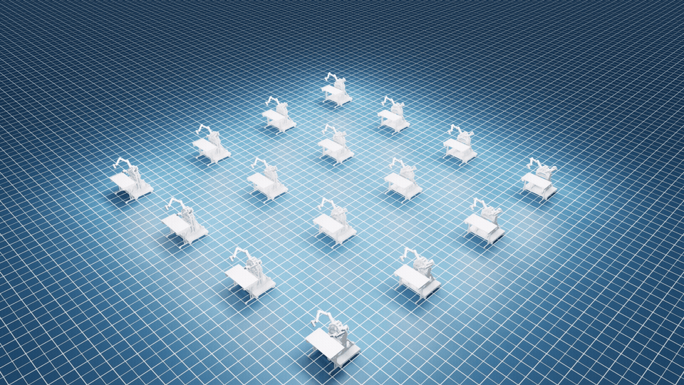
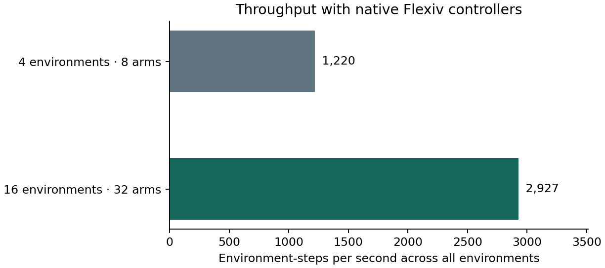

# Parallel Flexiv simulation in Isaac Lab

Run the same experiment across multiple Isaac Lab environments on one machine, with a native Flexiv controller driving each simulated arm. **16 environments and 32 Rizon 4s arms ran together on one GPU.**



[Watch the full-resolution demo](docs/sim_demo.mp4)

## Why parallel environments?

The official Flexiv bridge connects Isaac Sim to a robot running in Elements Studio. For two independent Rizon arms, Flexiv’s setup uses two computers, each running its own simulated controller. [Official Flexiv–Isaac bridge and multi-robot setup](https://github.com/flexivrobotics/isaac_sim_ws#multi-robot-support)

Large-scale reinforcement learning (RL) experiments collect experience by running many copies of a task in parallel. Isaac Lab can simulate those environments on one GPU, but Flexiv’s official setup requires a separate computer for each independently controlled arm. The choice of controller matters for sim-to-real transfer because the same action can produce different
motions or contact forces under a different low-level controller. This repository runs all the native Flexiv controllers on one workstation, so parallel experiments use the same low-level
control software as the physical arms.

This effort grew out of a project exploring how force feedback can refine the actions of vision-language-action (VLA) policies during contact-rich manipulation. Project poster (PDF)
(https://www.cs.toronto.edu/~kutyashev/assets/force-aware-poster.pdf?v=2)

## How it works

Reverse engineering the Flexiv controller binary revealed a hardcoded time-sync port. Two controller instances on the same host IP tried to open that port even when their serial numbers and configured communication ports differed.

For each arm, the launcher prepares a private copy of the controller with a dedicated time-sync port, assigns it a simulator identity and communication ports, and starts it alongside the other controllers. At each physics step, the Isaac Lab bridge sends each arm’s joint state to its assigned controller and applies the torques it receives to that arm. [Runtime preparation](scripts/controllers/prepare_robot_control_app_runtime.py) · [Environment allocator](scripts/controllers/generate_robot_run_manifest.py)

## Measured performance

With **16 two-arm environments**, 10,000 physics steps took **54.7 seconds** on one GPU. Each environment advanced **183 steps per second**, giving **2,927 environment-steps per second** in total. All 32 controllers supplied joint torques during the run. [Run measurements](results/connected-runs.csv) · [Per-arm samples](results/per-arm-samples.csv)



<details>
<summary>Physics-only baseline</summary>

This separate experiment measures how quickly Isaac advances the same two-arm scenes with controller communication disabled. It compares CPU physics and GPU physics, with and without rendering on the GPU.


[Baseline measurements](results/physics_scaling_data.csv)

</details>

## Try it

Generate the controller assignments for 16 environments on a laptop with Python 3.10 or newer. This example needs only the Python standard library.

```bash
python3 scripts/controllers/generate_robot_run_manifest.py \
  --num-environments 16 --role left --role right \
  --host-ip 127.0.0.1 --output /tmp/flexiv-32-arms.json
```

Open the JSON to see each arm’s environment index, role, serial number, and port block. To launch the simulation, follow the [GPU workstation setup](docs/run.md). [Code and data sources](docs/sources.md)

## What’s next

Scale to more environments on the same GPU and measure how controller response time and physics throughput change as more arms run concurrently.
