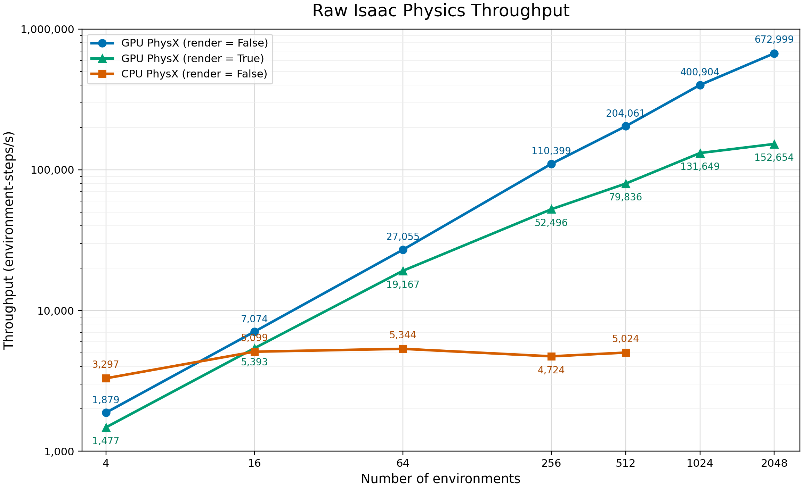

# Parallel Flexiv simulation in Isaac Lab

I wanted to run robotics experiments in parallel while keeping the same control software that drives a physical Flexiv arm. For a contact task such as inserting a peg, the controller’s response when the peg touches the socket is part of what you want to test. Running copies of that experiment side by side lets you vary the starting pose or the commanded motion and see how the controller responds in each trial.

Isaac Lab can simulate many copies of a workcell on one GPU. The stock Flexiv setup, however, supported only one controller-connected arm on a single host IP. Even a single two-arm workcell needed two controllers, and cloning its scene in Isaac did nothing to start them.

I reverse-engineered how Flexiv starts a simulated controller and built a launcher that gives every arm its own instance. With it, I ran **16 copies of a two-arm workcell on one GPU, with 32 native Flexiv controllers running on the same workstation**.


[Watch the full-resolution demo](docs/sim_demo.mp4)

## How it works

When I started a second arm, it failed even after I gave it a distinct serial number and communication ports. Both controllers were still trying to open the same time-sync port.

I traced that listener to a hardcoded port in the controller binary. The launcher prepares a private copy for each arm and assigns it a unique time-sync port, communication ports, and simulator identity. Isaac Lab clones the workcell on the GPU. At each physics step the bridge sends joint state to the corresponding Flexiv controller and applies its returned torques to that arm.

The [runtime preparation code](scripts/controllers/prepare_robot_control_app_runtime.py) handles the binary change. The [environment allocator](scripts/controllers/generate_robot_run_manifest.py) maps each left and right arm to its controller.

## Measured performance

With **16 two-arm environments**, 10,000 physics steps took **54.7 seconds** on one GPU. Each environment advanced **183 steps per second**, giving **2,927 environment-steps per second** in total. All 32 controllers supplied joint torques during the run. [Run measurements](results/connected-runs.csv) · [Per-arm samples](results/per-arm-samples.csv)


<details>
<summary>Physics-only baseline</summary>

This separate experiment measures how quickly Isaac advances the same two-arm scenes with controller communication disabled. It compares CPU physics and GPU physics, with and without rendering on the GPU.



[Baseline measurements](results/physics_scaling_data.csv)

</details>

## Try it

Generate the controller assignments for 16 environments on a laptop with Python 3.10 or newer. This example needs only the Python standard library.

```bash
python3 scripts/controllers/generate_robot_run_manifest.py \
  --num-environments 16 --role left --role right \
  --host-ip 127.0.0.1 --output /tmp/flexiv-32-arms.json
```

Open the JSON to see each arm’s environment index, role, serial number, and port block. To launch the simulation, follow the [GPU workstation setup](docs/run.md). [Code and data sources](docs/sources.md)

## What’s next

Scale to more environments on the same GPU and measure how controller response time and physics throughput change as more arms run concurrently.
